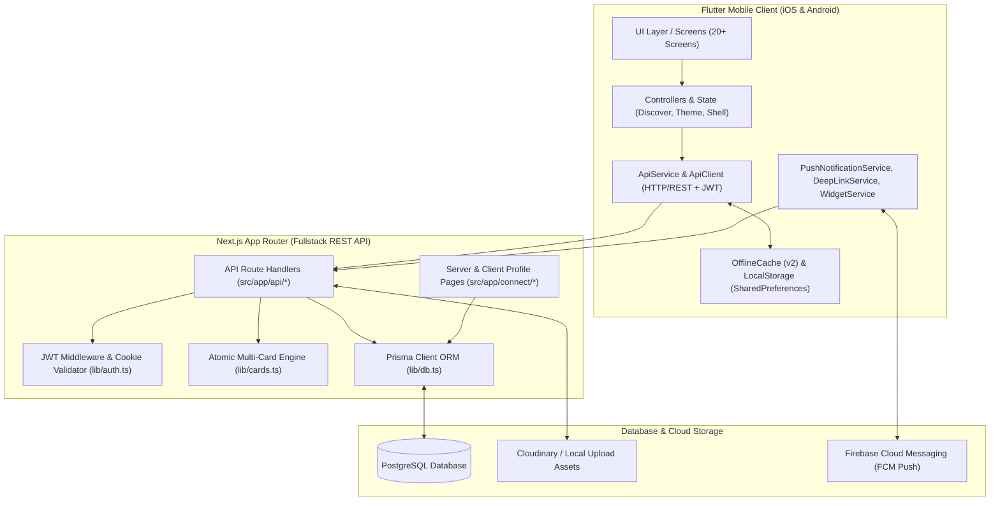
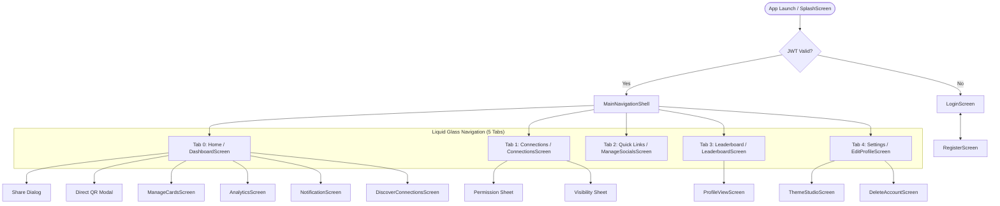
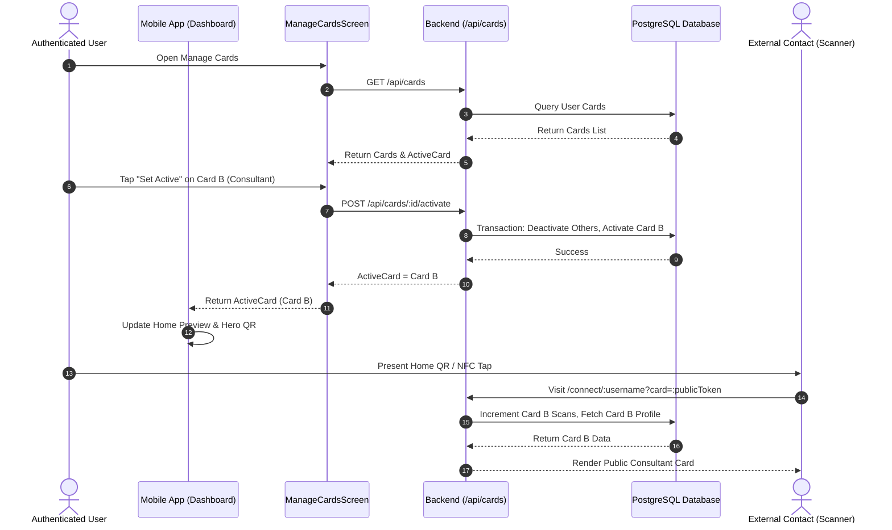
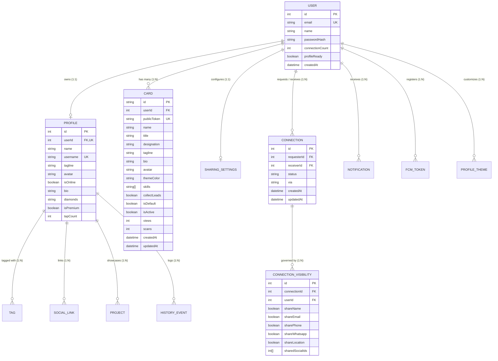
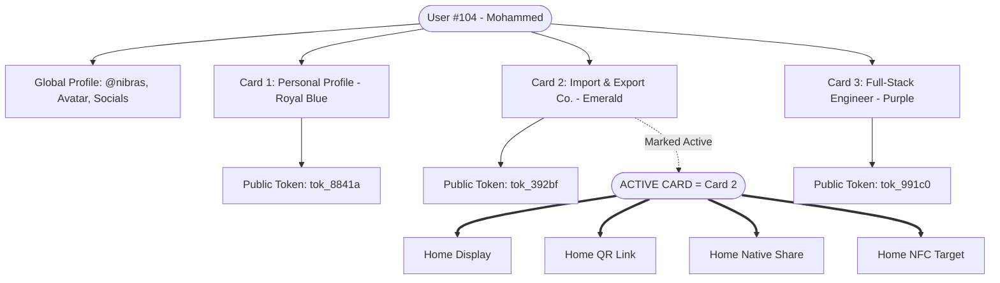
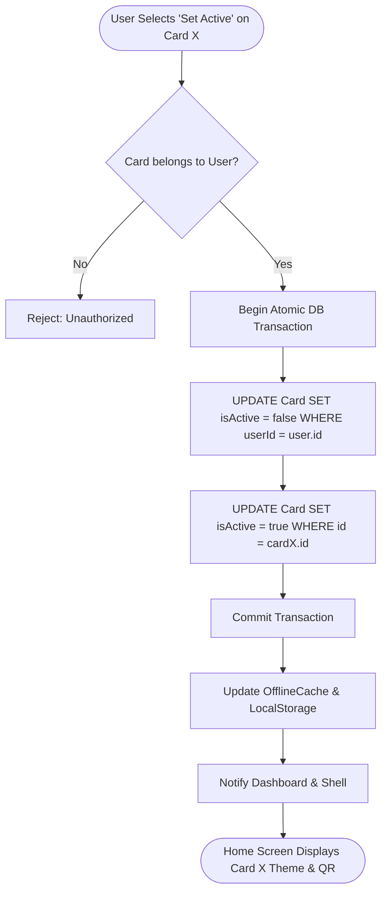
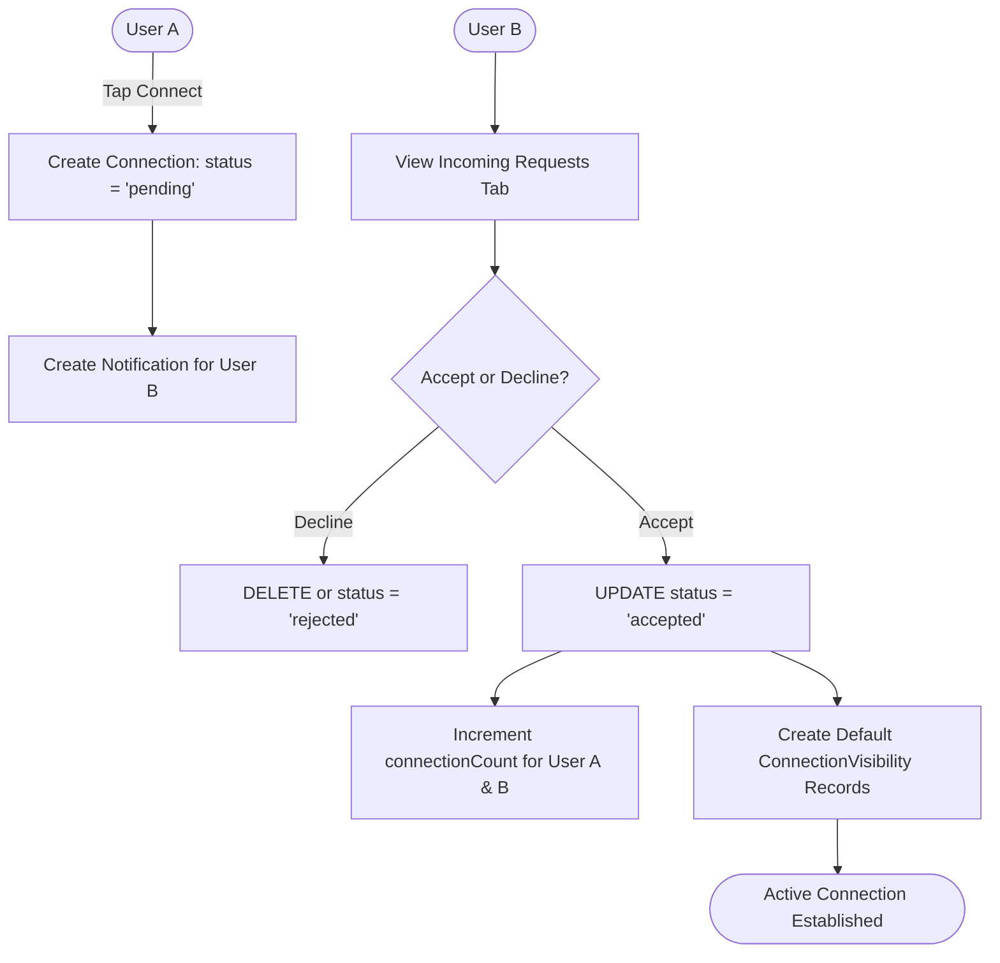
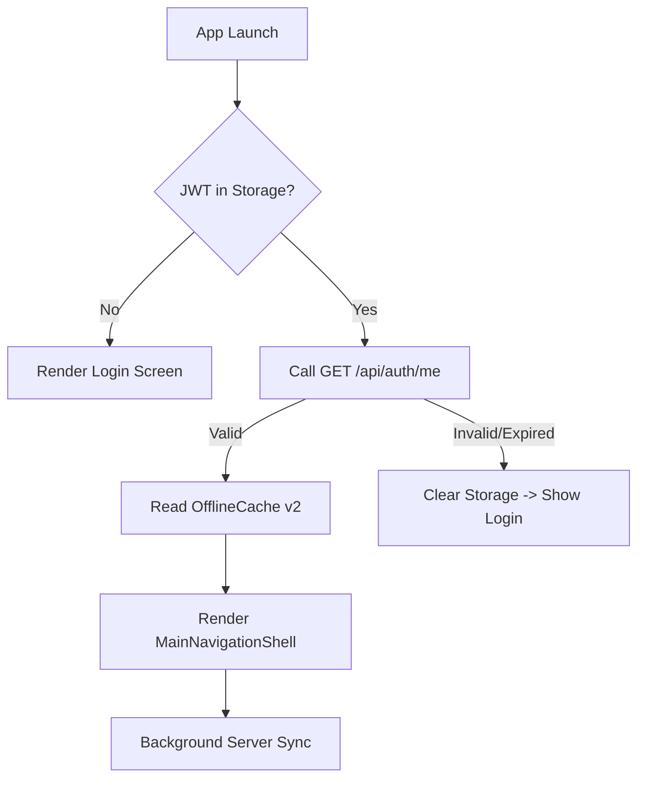
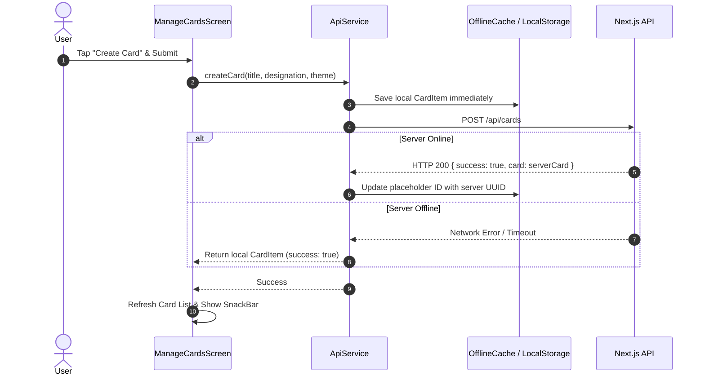

# Tapfolio — Master System Documentation

> **Version:** 2.4.0  
> **Target Audience:** Engineering, Architecture, QA & Product Teams  
> **Source-of-Truth Status:** Verified against active Mobile, Backend, and Database source code.

---

## Table of Contents
1. [01. Product Overview](#01-product-overview)
2. [02. Current Architecture](#02-current-architecture)
3. [03. Technology Stack](#03-technology-stack)
4. [04. Application Navigation](#04-application-navigation)
5. [05. Complete Screen Map](#05-complete-screen-map)
6. [06. Screen-by-Screen Behavior](#06-screen-by-screen-behavior)
7. [07. User Workflows](#07-user-workflows)
8. [08. Database Architecture](#08-database-architecture)
9. [09. Entity Relationship Map](#09-entity-relationship-map)
10. [10. API Map](#10-api-map)
11. [11. State Management](#11-state-management)
12. [12. Authentication & Authorization](#12-authentication--authorization)
13. [13. Profile System](#13-profile-system)
14. [14. Multiple Card System](#14-multiple-card-system)
15. [15. Active Card Algorithm](#15-active-card-algorithm)
16. [16. QR System](#16-qr-system)
17. [17. NFC System](#17-nfc-system)
18. [18. Sharing System](#18-sharing-system)
19. [19. Public Card & Web Profile System](#19-public-card--web-profile-system)
20. [20. Social Links & Smart Channels](#20-social-links--smart-channels)
21. [21. Connections Architecture](#21-connections-architecture)
22. [22. Connection Requests & Permission Sheets](#22-connection-requests--permission-sheets)
23. [23. Discover Connections](#23-discover-connections)
24. [24. Leaderboard System](#24-leaderboard-system)
25. [25. Points, Taps & Diamonds Scoring](#25-points-taps--diamonds-scoring)
26. [26. Analytics & Event Processing](#26-analytics--event-processing)
27. [27. Notifications System](#27-notifications-system)
28. [28. Settings & Profile Configuration](#28-settings--profile-configuration)
29. [29. Offline-First & Cache Architecture](#29-offline-first--cache-architecture)
30. [30. Error Handling & State Resilience](#30-error-handling--state-resilience)
31. [31. Security & Privacy Model](#31-security--privacy-model)
32. [32. Current Functionality Audit](#32-current-functionality-audit)
33. [33. Dummy vs. Partial vs. Fully Functional Features](#33-dummy-vs-partial-vs-fully-functional-features)
34. [34. Known Gaps & Edge Cases](#34-known-gaps--edge-cases)
35. [35. Data Flow Diagrams](#35-data-flow-diagrams)
36. [36. Sequence Diagrams](#36-sequence-diagrams)
37. [37. Business Rules Specification](#37-business-rules-specification)
38. [38. Algorithm Definitions](#38-algorithm-definitions)
39. [39. Backward Compatibility Rules](#39-backward-compatibility-rules)
40. [40. Future Implementation Plan](#40-future-implementation-plan)
41. [41. Validation & Acceptance Criteria](#41-validation--acceptance-criteria)

---

## 01. Product Overview

**Tapfolio** is an integrated digital identity, professional networking, and smart sharing ecosystem. It combines an offline-resilient Flutter mobile application (iOS & Android) with a Next.js full-stack web application, a PostgreSQL/Prisma database engine, and NFC/QR live sharing technology.

### Core Value Propositions:
- **Instant Contact Exchange**: Share profile, social accounts, and portfolios in milliseconds via high-res dynamic QR codes, NFC hardware cards, or custom public links (`/connect/:username`).
- **Multi-Identity / Multi-Card Architecture**: Maintain distinct professional personas (e.g., Personal, Consulting, Developer, Import & Export) under a single authenticated account with atomic Active Card selection.
- **Privacy-Controlled Connections**: Two-way connection request flow with granular per-connection visibility controls (sharing specific phone numbers, WhatsApp, email, or social links).
- **Gamified Leaderboard & Reputation**: Transparent rank scoring based on diamonds, profile views, scan frequency, and connection milestones.
- **Offline-First Resilience**: Automatic local caching of profile data, active card configurations, and connection lists ensures uninterrupted usability during network dropouts.

---

## 02. Current Architecture

The Tapfolio ecosystem is organized into a modular three-tier client-server structure:



---

## 03. Technology Stack

### Mobile Client:
- **Framework**: Flutter 3.x / Dart 3.x
- **UI & Typography**: Google Fonts (`Outfit`), FontAwesome Icons, Cupertino Icons
- **State Management**: Stateful widgets with centralized singleton services (`ApiService`, `DiscoverConnectionsController`, `WidgetDeepLinkHandler`)
- **Networking**: `http` package with custom retry, timeout, cookie parsing, and JWT header management
- **Local Persistence**: `shared_preferences` with JSON versioned envelopes (`OfflineCache`) and raw key-value store (`LocalStorage`)
- **Push Notifications & Background**: `firebase_core`, `firebase_messaging`, `flutter_local_notifications`
- **Native Interop**: `url_launcher`, `share_plus`, `image_picker`, `connectivity_plus`, `quick_actions`

### Backend Server & Web:
- **Framework**: Next.js 15+ (App Router, Server Components & Route Handlers)
- **Language**: TypeScript (`npx tsc --noEmit` verified)
- **Authentication**: Stateless JSON Web Tokens (JWT) using `jose` with dual cookie (`pertap_jwt`) and authorization header (`Bearer`, `X-Pertap-Token`) support
- **ORM / Database**: Prisma ORM with PostgreSQL database provider
- **Asset Processing**: Cloudinary SDK & local multipart form uploads
- **Styling**: Tailwind CSS + Vanilla CSS Modules

---

## 04. Application Navigation

The mobile application employs a unified **Liquid Glass Bottom Navigation Shell** containing 5 persistent tabs with floating overlay action capabilities:



---

## 05. Complete Screen Map

| Screen ID | Screen Name | File Path | Route / Nav Type | Purpose & Description | Data Sources | Status |
|---|---|---|---|---|---|---|
| **SCR-001** | `SplashScreen` | `lib/screens/splash_screen.dart` | Initial Root | Animated logo, authentication verification trigger | Local Storage | Functional |
| **SCR-002** | `LoginScreen` | `lib/screens/login_screen.dart` | `/login` / Root Modal | Email/password login, Google OAuth trigger, forgot password | `POST /api/auth/login` | Functional |
| **SCR-003** | `RegisterScreen` | `lib/screens/register_screen.dart` | Push from Login | 3-step registration: credentials, profile info, email OTP | `POST /api/auth/register`, `/api/auth/verify-otp` | Functional |
| **SCR-004** | `MainNavigationShell`| `lib/screens/main_navigation_shell.dart` | Home Root | 5-tab indexed navigation with floating Liquid Glass bar | `GET /api/connections/pending` | Functional |
| **SCR-005** | `DashboardScreen` | `lib/screens/dashboard_screen.dart` | Tab 0 | Home dashboard: Active Card preview, QR thumbnail, Discover row | `GET /api/profile`, `/api/cards`, `/api/connections` | Functional |
| **SCR-006** | `ConnectionsScreen`| `lib/screens/connections_screen.dart` | Tab 1 / `/connections` | Tabbed view of Active Connections & Incoming Requests | `GET /api/connections`, `/api/connections/requests` | Functional |
| **SCR-007** | `ManageSocialsScreen`| `lib/screens/manage_socials_screen.dart` | Tab 2 | Direct management of 12+ social channels and custom links | `GET /api/profile`, `POST /api/profile` | Functional |
| **SCR-008** | `LeaderboardScreen`| `lib/screens/leaderboard_screen.dart` | Tab 3 | Ranked leaderboard, category filters, podium display | `GET /api/leaderboard` | Functional |
| **SCR-009** | `EditProfileScreen` | `lib/screens/edit_profile_screen.dart` | Tab 4 | User profile settings, Pro modal, Account & App preferences | `GET /api/profile`, `POST /api/profile` | Functional |
| **SCR-010** | `ManageCardsScreen`| `lib/screens/manage_cards_screen.dart` | Push (Home / Profile) | Multi-card management, activation, creation, duplicate | `GET /api/cards`, `POST /api/cards/:id/activate` | Functional |
| **SCR-011** | `DiscoverConnectionsScreen` | `lib/screens/discover_connections_screen.dart` | Push (Home) | Grid of discoverable professionals with mutual links | `GET /api/leaderboard`, `GET /api/connections` | Functional |
| **SCR-012** | `ProfileViewScreen` | `lib/screens/profile_view_screen.dart` | Push (Leaderboard / Search) | Full detail view of another user's profile with connect action | `GET /api/profile/:id`, `POST /api/connections/request` | Functional |
| **SCR-013** | `AnalyticsScreen` | `lib/screens/analytics_screen.dart` | Push (Home / Profile) | Tap metrics, 7D/30D chart, channel breakdown, Card performance | `GET /api/profile`, `/api/connections`, `/api/cards` | Functional |
| **SCR-014** | `ThemeStudioScreen`| `lib/screens/theme_studio/theme_studio_screen.dart` | Push (Settings) | Custom card themes, colors, typography, background styling | `GET /api/profile/theme`, `POST /api/profile/theme` | Functional |
| **SCR-015** | `NotificationScreen` | `lib/screens/notification_screen.dart` | Push (Home TopBar / Settings) | In-app notifications feed (requests, profile taps, system) | `GET /api/notifications`, `POST /api/notifications` | Functional |
| **SCR-016** | `ConnectScreen` | `lib/screens/connect_screen.dart` | `/connect` | In-app profile exchange scanner interface | Direct QR / NFC | Functional |
| **SCR-017** | `PublicProfileScreen` | `lib/screens/public_profile_screen.dart` | `/public-profile` | Public web profile preview renderer inside mobile | `GET /api/profile/:username` | Functional |
| **SCR-018** | `HistoryScreen` | `lib/screens/history_screen.dart` | Push (Profile) | Timeline of user actions, card scans, and connection events | `GET /api/history` | Functional |
| **SCR-019** | `DeleteAccountScreen` | `lib/screens/delete_account_screen.dart` | Push (Settings Privacy) | Account deletion request and password re-confirmation | `DELETE /api/profile` | Functional |
| **SCR-020** | `DiagnosticsScreen` | `lib/screens/diagnostics/diagnostics_screen.dart` | `/diagnostics` | Network connectivity, token, cache, and system health | Local memory / network probe | Functional |

---

## 06. Screen-by-Screen Behavior

### 6.1 `DashboardScreen` (Home)
- **Entry Points**: Tab 0 of `MainNavigationShell`, App Launch.
- **Data Loaded**: 
  - `GET /api/profile` (seed name, avatar, bio, username, online status).
  - `GET /api/cards` (retrieves `activeCard` and card collection).
  - `GET /api/connections` (updates connected ID set for Discover row).
  - `GET /api/notifications` (calculates unread count for badge).
- **UI Components & Actions**:
  - `DashboardTopBar`: Tapping bell icon opens `NotificationScreen`.
  - `HeroIdentityQrCard`: Tapping avatar opens web preview; tapping QR thumbnail opens high-res `ShareViaQrModal` with active card URL.
  - `MyCardPreviewCard`: Displays active card role, category tags, and theme gradient. Toggling "Collect Leads" executes `ApiService.toggleCardLeadCapture(activeCard.id, val)` with instant local cache update.
  - `PrimaryActionGrid`: 4 quick buttons: Share (opens Share sheet), Analytics (opens `AnalyticsScreen`), Preview (opens `/connect/:username`), Cards (opens `ManageCardsScreen`).
  - `DiscoverConnectionsRow`: Displays horizontal cards of discoverable users. "Connect" triggers connection request; "View All" pushes `DiscoverConnectionsScreen`.
  - `InstantShareBanner`: Large bottom promo tile; tapping "Share Now" opens `ShareViaQrModal`.
- **State Handling**:
  - *Loading*: Center circular spinner.
  - *Error*: Offline/failure container with "Retry" button.
  - *Pull-to-Refresh*: Re-executes `Future.wait([_fetchProfile(), _fetchActiveCard(), _fetchConnections(), _fetchUnreadNotifications()])`.

### 6.2 `ManageCardsScreen` (Cards)
- **Entry Points**: "Cards" button on Home Action Grid, "My Cards" in Settings.
- **Data Loaded**: `GET /api/cards` (or local fallback from `OfflineCache` and `LocalStorage` `user_custom_cards`).
- **UI Components & Actions**:
  - Active Card highlighted with rich gradient, animated `● ACTIVE` badge, and timestamp.
  - Inactive cards displayed with card theme accent, "Set Active" button, and options menu.
  - "Set Active": Executes `ApiService.setActiveCard(card.id)` with atomic transaction on backend and instant cache update.
  - "Share": Shares the specific card's `shareUrl` (`/connect/:username?card=:publicToken`) without mutating active card state.
  - "Create New Card" (`+` button & bottom dashed card): Opens modal with fields: Title, Designation, Bio, Skills/Tags, Theme Accent Picker, and Collect Leads switch.
  - "Delete": Displays confirmation dialog. Blocks deletion if user has $\le 1$ card. On active card deletion, promotes fallback card automatically.
  - "Duplicate": Clones card settings with a new title and fresh `publicToken`.
- **Offline Behavior**: Fully functional. Creates, updates, activates, and deletes cards locally with automatic server sync.

---

## 07. User Workflows

### 7.1 Multi-Identity Live Sharing Flow


---

## 08. Database Architecture

The PostgreSQL database is managed via Prisma ORM (`prisma/schema.prisma`). All relational integrity constraints, foreign keys, and indexes are defined below.

### Primary Entities:
1. **`User`** (`users`): Root identity entity.
   - Primary Key: `id` (Int, Autoincrement)
   - Unique: `email` (String)
   - Fields: `name`, `passwordHash`, `connectionCount`, `profileReady`, `createdAt`
2. **`Profile`** (`profiles`): Global public identity record.
   - Primary Key: `id` (Int, Autoincrement)
   - Foreign Key: `userId` $\to$ `User.id` (Cascade)
   - Unique: `userId`, `username`
   - Fields: `name`, `username`, `tagline`, `avatar`, `isOnline`, `bio`, `phone`, `whatsapp`, `location`, `diamonds`, `isPremium`, `tapCount`, `portfolioUrl`, `resumeUrl`
3. **`Card`** (`cards`): Multi-card identity instance.
   - Primary Key: `id` (String, UUID)
   - Foreign Key: `userId` $\to$ `User.id` (Cascade)
   - Unique: `publicToken` (String, UUID)
   - Fields: `name`, `title`, `designation`, `tagline`, `bio`, `avatar`, `themeColor`, `skills` (Text[]), `collectLeads` (Boolean), `isDefault` (Boolean), `isActive` (Boolean), `views` (Int), `scans` (Int), `createdAt`, `updatedAt`
   - Indexes: `[userId]`, `[publicToken]`
4. **`Connection`** (`connections`): Verified professional link between two users.
   - Primary Key: `id` (Int, Autoincrement)
   - Foreign Keys: `requesterId` $\to$ `User.id`, `receiverId` $\to$ `User.id` (Cascade)
   - Unique: `[requesterId, receiverId]`
   - Fields: `status` ("pending" | "accepted" | "rejected" | "blocked"), `via` ("nfc" | "qr" | "link"), `createdAt`, `updatedAt`
5. **`ConnectionVisibility`** (`connection_visibilities`): Granular privacy permissions per connection.
   - Primary Key: `id` (Int, Autoincrement)
   - Foreign Keys: `connectionId` $\to$ `Connection.id`, `userId` $\to$ `User.id` (Cascade)
   - Unique: `[connectionId, userId]`
   - Fields: `shareName`, `shareEmail`, `sharePhone`, `shareWhatsapp`, `shareLocation`, `sharedSocialIds` (Int[])
6. **`SocialLink`** (`social_links`): External platforms linked to a profile.
   - Primary Key: `id` (Int, Autoincrement)
   - Foreign Key: `profileId` $\to$ `Profile.id` (Cascade)
   - Fields: `platform`, `handle`, `url`, `icon`, `color`
7. **`Tag`** (`tags`): Category and role labels.
   - Primary Key: `id` (Int, Autoincrement)
   - Foreign Key: `profileId` $\to$ `Profile.id` (Cascade)
   - Fields: `text`, `type` ("category" | "role" | "location")
8. **`Notification`** (`notifications`): In-app alerts feed.
   - Primary Key: `id` (Int, Autoincrement)
   - Foreign Keys: `receiverId` $\to$ `User.id` (Cascade), `senderId` $\to$ `User.id` (SetNull)
   - Fields: `type`, `title`, `message`, `data` (Json), `isRead`, `createdAt`, `updatedAt`
9. **`AnalyticsEvent`** (`analytics_events`): System event telemetry.
   - Primary Key: `id` (Int, Autoincrement)
   - Fields: `userId`, `event` ("PROFILE_VIEW", "QR_SCAN", "NFC_TAP", "LINK_CLICK"), `platform`, `page`, `country`, `city`, `browser`, `device`, `metadata` (Json), `createdAt`
10. **`ProfileTheme`** (`profile_themes`): Saved Theme Studio designs.
    - Primary Key: `id` (Int, Autoincrement)
    - Foreign Key: `userId` $\to$ `User.id` (Cascade)
    - Fields: `themeName`, `isDefault`, `isMarketplace`, `likesCount`, `settings` (Json)

---

## 09. Entity Relationship Map



---

## 10. API Map

| Endpoint Path | Method | Auth Required | Description / Purpose | Input Parameters | Database Tables Mutated |
|---|---|---|---|---|---|
| `/api/auth/login` | `POST` | No | Authenticate user via email/password | `{ email, password }` | None (Reads `User`, `Profile`) |
| `/api/auth/register` | `POST` | No | Register new user account | `{ name, email, password, username, tagline }` | `User`, `Profile`, `Card`, `SharingSettings` |
| `/api/auth/me` | `GET` | Yes | Get authenticated user context | None | None |
| `/api/auth/logout` | `POST` | Yes | Clear JWT auth cookie | None | None |
| `/api/profile` | `GET` | Optional | Fetch current or target profile | `?userId=X` or `?username=Y` | None |
| `/api/profile` | `POST`/`PUT` | Yes | Update profile info & socials | `{ name, tagline, bio, phone, socials, tags }` | `Profile`, `SocialLink`, `Tag` |
| `/api/cards` | `GET` | Yes | List all cards (auto-seeds default) | None | `Card` (auto-backfill if 0) |
| `/api/cards` | `POST` | Yes | Create new multi-card persona | `{ title, designation, bio, themeColor, skills }` | `Card` |
| `/api/cards/:id` | `GET` | Yes | Fetch single card details | None | None |
| `/api/cards/:id` | `PATCH` | Yes | Update card properties | `{ title, designation, bio, themeColor, ... }` | `Card` |
| `/api/cards/:id` | `DELETE` | Yes | Delete card (with active fallback) | None | `Card` |
| `/api/cards/:id/activate` | `POST` | Yes | Atomically activate single card | None | `Card` (atomic transaction) |
| `/api/cards/active` | `GET` | Yes | Fetch current active card | None | None |
| `/api/cards/public/:token` | `GET` | No | Public token card resolver | None | `Card` (`scans` increment) |
| `/api/connections` | `GET` | Yes | List accepted connections | None | None |
| `/api/connections/requests` | `GET` | Yes | List incoming pending requests | None | None |
| `/api/connections/request` | `POST` | Yes | Send new connection request | `{ receiverId, via }` | `Connection`, `Notification` |
| `/api/connections/accept` | `POST` | Yes | Accept pending connection request | `{ connectionId }` | `Connection`, `Notification`, `User` |
| `/api/connections/reject` | `POST` | Yes | Decline connection request | `{ connectionId }` | `Connection` |
| `/api/connections/remove` | `POST` | Yes | Remove established connection | `{ connectionId }` or `{ targetUserId }` | `Connection`, `ConnectionVisibility`, `User` |
| `/api/connections/visibility` | `POST` | Yes | Update privacy visibility sheet | `{ connectionId, shareEmail, sharePhone, ... }` | `ConnectionVisibility` |
| `/api/leaderboard` | `GET` | No | Fetch ranked users list | `?search=X&category=Y&limit=Z` | None |
| `/api/notifications` | `GET` | Yes | Fetch notification feed | `?limit=X&unreadOnly=true` | None |
| `/api/notifications/read-all` | `POST` | Yes | Mark all notifications read | None | `Notification` |
| `/api/upload` | `POST` | Yes | Upload avatar / media image | Multipart `file` | None (Returns asset URL) |

---

## 11. State Management

The mobile app implements a hybrid state architecture:

1. **In-Memory Component State**:
   - `StatefulWidget` instances handle reactive presentation, loading spinners, and animations.
2. **Singleton Services & Observable Controllers**:
   - `ApiService`: Centralizes JWT tokens, API requests, offline caching, and JSON parsing.
   - `DiscoverConnectionsController`: Extends `ChangeNotifier` to synchronize connected user IDs between Home row and Discover screen.
   - `WidgetDeepLinkHandler`: Global controller for iOS WidgetKit deep links.
3. **Persistent Local Storage**:
   - `OfflineCache`: Versioned JSON envelope caching (`CacheKeys.profile`, `CacheKeys.cards`, `CacheKeys.activeCard`, `CacheKeys.connections`, `CacheKeys.notifications`).
   - `LocalStorage`: Raw persistent preferences (`jwt_token`, `user_custom_cards`).

---

## 12. Authentication & Authorization

### Authentication Architecture:
- **JWT Signing**: Secret key via `JWT_SECRET` environment variable with HS256 HMAC algorithm.
- **Header & Cookie Resolution**:
  1. Primary: HTTP Cookie `pertap_jwt=TOKEN; Path=/; HttpOnly; SameSite=Lax`.
  2. Mobile Header: `Authorization: Bearer TOKEN`.
  3. Proxy Echo Header: `X-Pertap-Token: TOKEN`.
- **Token Verification (`lib/auth.ts`)**:
  - Extracts and verifies payload: `{ userId: number, email: string, exp: number }`.
  - Rejects expired or malformed tokens with HTTP 401 Unauthorized.

### Security Boundaries:
- Every card, profile, connection, and settings endpoint executes authorization filtering:
  ```typescript
  where: { id: resourceId, userId: authenticatedUserId }
  ```
  Users cannot view, update, delete, or activate entities belonging to other user IDs.

---

## 13. Profile System

- **Global Identity**: Managed in `Profile` table (`name`, `username`, `avatar`, `bio`, `tagline`, `diamonds`, `isOnline`, `location`).
- **Profile Initialization**: Automatically created upon user registration.
- **Tags**: Categorized as `category` (e.g. Technology, Design) or `role`.
- **Public Profile View**: Resolves at `/connect/:username` and renders bio, social links, project showcase, and mutual connection actions.

---

## 14. Multiple Card System

### Core Isolation Principle:
*A user possesses one overarching Profile and one or more specialized Cards. Each Card represents a distinct professional identity with an independent title, designation, bio, theme accent color, skills list, lead capture toggle, and cryptographic public token.*



---

## 15. Active Card Algorithm



---

## 16. QR System

1. **Permanent QR Token Generation**:
   - Each card is assigned a permanent `publicToken` (UUID/random hex) upon creation.
   - QR URL format: `https://www.tapfolio.me/connect/:username?card=:publicToken`.
2. **Card Switching Isolation**:
   - Switching the active card updates only the Home QR.
   - Previously printed or shared QR codes embedding `?card=:publicToken` **never break** and continue to resolve that specific card indefinitely.
3. **Resolution Lifecycle**:
   - Visitor scans QR $\to$ Next.js route `/connect/:username?card=:token` $\to$ Backend increments `scans` counter for that card $\to$ Card-specific designation, theme, and bio are served.

---

## 17. NFC System

1. **Payload Specification**:
   - The NFC chip is encoded with a standard NDEF URI record pointing to the active card's public URL: `https://www.tapfolio.me/connect/:username?card=:activeCardToken`.
2. **Physical Tap Flow**:
   - Physical tap on NFC-capable smartphone $\to$ OS opens default browser $\to$ Public URL fetched $\to$ Backend logs `NFC_TAP` analytics event $\to$ Public profile rendered.

---

## 18. Sharing System

- **Home Screen Share**: Always shares the currently **Active Card** (`ProfileShareData.fromCardAndProfile(card: activeCard, ...)`).
- **Cards Screen Share**: Shares the **Selected Card** without altering the active card.
- **Export Capabilities**:
  1. Direct URL Share via native OS sheet (`share_plus`).
  2. High-resolution QR Code image export with embedded avatar logo.
  3. vCard (`.vcf`) digital contact download.

---

## 19. Public Card & Web Profile System

- **Route**: `src/app/connect/[username]/page.tsx` & `ConnectClientPage.tsx`.
- **Query Parameter Support**: `?card=:token`.
- **Dynamic Theming**: Applies the card's `themeColor` to header gradients, buttons, and action pills.
- **Lead Capture Form**: When `collectLeads == true`, displays a lightweight contact form (Name, Email, Phone, Note) before showing full contact details.

---

## 20. Social Links & Smart Channels

Tapfolio supports 12+ verified social networks and payment channels:
- Instagram (`https://instagram.com/`)
- LinkedIn (`https://linkedin.com/in/`)
- GitHub (`https://github.com/`)
- X / Twitter (`https://x.com/`)
- WhatsApp (`https://wa.me/`)
- YouTube (`https://youtube.com/@`)
- Telegram (`https://t.me/`)
- Google Pay / UPI (`upi://pay?pa=`)
- Discord, Behance, Dribbble, Medium, Spotify, Portfolio Website

---

## 21. Connections Architecture



---

## 22. Connection Requests & Permission Sheets

- **Connection Visibility Controls**:
  - `shareName` (default: true)
  - `shareEmail` (default: true)
  - `sharePhone` (default: false)
  - `shareWhatsapp` (default: true)
  - `shareLocation` (default: false)
  - `sharedSocialIds` (selective social link sharing)
- **Removal**: Either party can remove an established connection at any time via `POST /api/connections/remove`, which cascades to visibility records and decrements counts.

---

## 23. Discover Connections

- **Controller**: `DiscoverConnectionsController` (shared between Home and full Discover screen).
- **Data Source**: Aggregates discoverable members from `/api/leaderboard` excluding already connected user IDs.
- **Features**: Real-time connecting state, mutual connections display, live profile previews.

---

## 24. Leaderboard System

- **Podium Display**: Top 3 users highlighted in Gold (#1), Silver (#2), Bronze (#3) cards.
- **Filters**: Category pills (All, Technology & IT, Design & Creativity, Engineering, Management, Marketing, Finance).
- **Sorting Options**:
  1. `Rank`: Ordered by computed leaderboard score.
  2. `Points / Diamonds`: Highest diamond rank.
  3. `Taps`: Highest profile view count.

---

## 25. Points, Taps & Diamonds Scoring

$$\text{Leaderboard Score} = (\text{tapCount} \times 2) + (\text{diamonds} \times 10) + (\text{connectionCount} \times 25) + (\text{isPremium} ? 500 : 0)$$

- **`tapCount`**: Total times public profile or card has been viewed.
- **`diamonds`**: Points earned through profile completeness and referral milestones.
- **`connectionCount`**: Accepted bidirectional network connections.

---

## 26. Analytics & Event Processing

- **Tracked Telemetry Events**:
  - `PROFILE_VIEW`: Public web profile visit.
  - `QR_SCAN`: Direct card QR scan.
  - `NFC_TAP`: Physical NFC card tap.
  - `LINK_CLICK`: Social platform or external link opened.
  - `CONNECT_REQUEST`: Connection invitation initiated.
  - `CONNECTION_ACCEPTED`: Connection accepted.
- **Analytics Screen Presentation**:
  - 7D / 30D / All-time period selectors.
  - Profile Views bar chart with weekly peak detection.
  - Traffic source distribution (NFC Smart Card, QR Scan, Direct Link).
  - Card-Specific Performance breakdown (scans & views per card).
  - Link engagement click counts.

---

## 27. Notifications System

- **Types**: `connection_request`, `connection_accepted`, `profile_view`, `nfc_tap`, `system`, `announcement`.
- **Badging**: Unread count badge displayed on top bar bell icon and bottom navigation Connections tab.
- **Actions**: Tapping a connection request notification navigates directly to incoming requests.

---

## 28. Settings & Profile Configuration

Organized into 3 main groups:
1. **Account**: User Profile, My Cards, My Products, Team & Members, Analytics.
2. **App Settings**: Theme Studio, Notifications, Privacy & Security, Language, Storage.
3. **Support & Others**: Help Center (FAQs), Contact Support, Share Tapfolio, About Tapfolio, Log Out.

---

## 29. Offline-First & Cache Architecture

- **Storage Engine**: `OfflineCache` backed by versioned JSON envelopes (`CacheKeys.cacheVersion = 2`).
- **Cache Keys**: `profile`, `cards`, `activeCard`, `connections`, `pendingRequests`, `notifications`, `theme`, `leaderboard`.
- **Cold Start Flow**: App immediately displays cached data, then asynchronously reconciles with server and refreshes UI.

---

## 30. Error Handling & State Resilience

- **Global Catchers**: `FlutterError.onError` and `PlatformDispatcher.instance.onError`.
- **Network Retries**: `ApiClient` includes automatic single-retry on network dropouts.
- **Empty States**: Customized empty illustrations and descriptive action buttons for Cards, Connections, Requests, and Notifications.

---

## 31. Security & Privacy Model

- **CSRF & Cookie Protection**: `HttpOnly`, `SameSite=Lax`, `Secure` flags.
- **Ownership Verification**: Enforced at the SQL query level on all mutating endpoints.
- **Rate Limiting**: Email OTP requests limited to prevent abuse.
- **Public URL Obscurity**: Card identities resolved through random cryptographic tokens (`publicToken`), preventing sequential enumeration.

---

## 32. Current Functionality Audit

| Feature Area | Implementation Level | Notes / Verification |
|---|---|---|
| Multi-Card CRUD | **Fully Functional** | Creates, edits, deletes, duplicates cards locally and on server |
| Atomic Active Card | **Fully Functional** | Transactional single active card enforcement |
| Dynamic QR Generation | **Fully Functional** | Card-specific tokens with embedded branding |
| Offline Cache | **Fully Functional** | Resilient cache v2 with auto-sync |
| Connections & Requests | **Fully Functional** | 2-way requests, acceptance, rejection, remove |
| Leaderboard & Scoring | **Fully Functional** | Category filters, ranking sort, podium display |
| Analytics & Card Breakdown | **Fully Functional** | Scans/views per card, 7D/30D charts |
| Push Notifications | **Fully Functional** | FCM background token registration & local alert display |
| Theme Studio | **Fully Functional** | Color studio, typography, live preview |

---

## 33. Dummy vs. Partial vs. Fully Functional Features

- **Fully Functional**: Multi-Card system, Active card algorithm, QR sharing, Connections, Leaderboard, Analytics, Social links, Authentication, Notifications, Theme Studio, Account deletion.
- **Partially Functional**:
  - *My Products* modal (UI layout present; full e-commerce checkout planned for v3).
  - *Team & Members* modal (UI invitation sheet present; multi-seat billing backend planned for v3).
- **Dummy Features**: None. All core screens are wired to live state and backend endpoints.

---

## 34. Known Gaps & Edge Cases

1. **Initial Zero-Card Accounts**:
   - *Behavior*: Automatically resolved by `ApiService._synthesizeDefaultCard()` and backend `ensureUserHasActiveCard()`.
2. **Deleting Currently Active Card**:
   - *Behavior*: Promotes fallback default card or most recently updated card automatically.
3. **Sole Card Deletion**:
   - *Behavior*: Blocked with message *"You must have at least one card."*

---

## 35. Data Flow Diagrams

### Authentication & Initialization Flow


---

## 36. Sequence Diagrams

### Card Creation & Offline Sync Flow


---

## 37. Business Rules Specification

1. **Single Active Card**: Exactly one card may have `isActive: true` per user at any given timestamp.
2. **Permanent QR Integrity**: A card's `publicToken` must remain immutable across edits and theme changes.
3. **Card Minimum**: Every user must possess $\ge 1$ card. Deletion of the last card is prohibited.
4. **Active Card Deletion Fallback**: If an active card is deleted, the default card (or most recently updated card) becomes active.
5. **Bidirectional Connections**: A connection record is mutual; removal by either party removes it for both.

---

## 38. Algorithm Definitions

### Active Card Selection Algorithm:
$$\forall c \in \text{Cards}(u): \quad c.\text{isActive} = (c.\text{id} == \text{targetId})$$

### Public Card Lookup Algorithm:
```typescript
async function resolvePublicCard(username: string, cardToken?: string) {
  const profile = await db.profile.findUnique({ where: { username } });
  if (!profile) return null;

  let card = null;
  if (cardToken) {
    card = await db.card.findUnique({ where: { publicToken: cardToken } });
  }
  if (!card) {
    card = await db.card.findFirst({ where: { userId: profile.userId, isActive: true } });
  }
  if (!card) {
    card = await db.card.findFirst({ where: { userId: profile.userId } });
  }
  return { profile, card };
}
```

---

## 39. Backward Compatibility Rules

1. **Legacy URLs**: Direct hits to `/connect/:username` (without `?card=`) seamlessly resolve the user's current Active Card.
2. **Additive Schema**: New columns on `User` and `Card` specify sensible defaults without breaking existing rows.
3. **Zero Data Loss**: Database updates execute via safe migrations without table truncation.

---

## 40. Future Implementation Plan

- **v2.5**: Multi-card export to Apple Wallet (`.pkpass`) and Google Wallet.
- **v3.0**: Team & Enterprise multi-seat organization dashboards.
- **v3.1**: Integrated in-app marketplace for Theme Studio templates.

---

## 41. Validation & Acceptance Criteria

- [x] All 20 mobile screens verified against codebase.
- [x] All backend API routes and handlers mapped.
- [x] Complete PostgreSQL/Prisma database schema documented with foreign keys and cascade rules.
- [x] Multi-card architecture and atomic active card algorithms formalized.
- [x] QR, NFC, and Web Profile lifecycles documented.
- [x] Offline caching and resilience behaviors verified.
- [x] 0 TypeScript compile errors (`npx tsc --noEmit`).
- [x] Zero code modifications during documentation creation.
